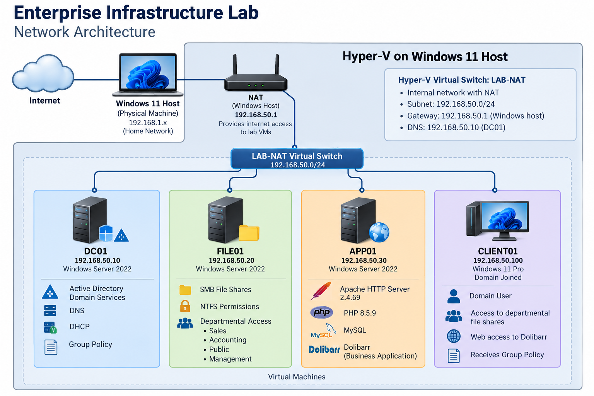

# Windows Server Enterprise Infrastructure Lab

A hands-on IT infrastructure project designed to simulate the systems and services used in a small business environment.

The lab consists of four virtual machines running on Microsoft Hyper-V, providing Active Directory authentication, DNS, DHCP, Group Policy, departmental file sharing, and business application hosting.

The project demonstrates practical skills in Windows Server administration, infrastructure deployment, networking, access management, PowerShell automation, and technical troubleshooting.

## Infrastructure Overview

| Server | IP Address | Function |
|---|---|---|
| DC01 | 192.168.50.10 | Active Directory, DNS, DHCP, Group Policy |
| FILE01 | 192.168.50.20 | Departmental file sharing and permissions |
| APP01 | 192.168.50.30 | Apache, PHP, MySQL, business application hosting |
| CLIENT01 | 192.168.50.100 | Windows 11 domain-joined workstation |

**Virtualisation:** Microsoft Hyper-V  
**Network:** 192.168.50.0/24  
**Virtual Switch:** LAB-NAT (Internal)  
**Domain:** corp.example.test  
**NAT:** Windows host-based NAT

## Active Directory and Group Policy

Deployed Windows Server 2022 as a domain controller and configured Active Directory Domain Services, DNS, and DHCP.

Created an organisational structure representing a small business with departments including Accounting, Sales, Management, IT, and Field Engineers.

Implemented departmental security groups and Group Policy Objects to manage user access and workstation restrictions.

Troubleshot a Group Policy issue involving a user-based restriction linked to a computer OU. Corrected the policy targeting and verified application using Group Policy reporting tools.

## File Server and Access Management

Configured FILE01 as a domain-joined Windows Server 2022 file server with a dedicated NTFS data volume.

Created departmental SMB shares with access controlled through Active Directory security groups.

Configured both share-level and NTFS permissions to provide departmental users with appropriate access.

Validated access controls using a standard Sales domain account:

- Sales share: Access granted.
- Public share: Access granted.
- Accounting share: Access denied.

This demonstrated the successful enforcement of departmental access restrictions.

## Application Server

Configured APP01 as a domain-joined Windows application server.

Installed and configured:

- Apache HTTP Server 2.4.69
- PHP 8.5.9
- MySQL
- Dolibarr business application

Troubleshot PHP extension dependencies and investigated HTTP connectivity between the application server and client workstation.

Verified that the web server was accessible from CLIENT01.

## PowerShell Automation

Developed a CSV-driven PowerShell script to automate Active Directory user provisioning.

The script:

- Imports employee information from a CSV file.
- Generates usernames using the employee's first initial and surname.
- Creates user accounts in departmental organisational units.
- Assigns users to departmental Active Directory security groups.
- Checks for existing accounts before provisioning.
- Requires a password change at first login.

Successfully tested the script using fictional employee accounts.

## Technical Skills Demonstrated

- Windows Server 2022
- Active Directory Domain Services
- Group Policy
- DNS and DHCP
- Hyper-V virtualisation
- TCP/IP networking and NAT
- SMB file sharing and NTFS permissions
- Active Directory security groups
- PowerShell automation
- Apache, PHP, and MySQL
- Infrastructure troubleshooting

## Project Scope

This is an independently developed technical lab intended for hands-on learning, experimentation, and demonstration of IT administration skills.

The environment simulates business infrastructure but is not a production deployment.
